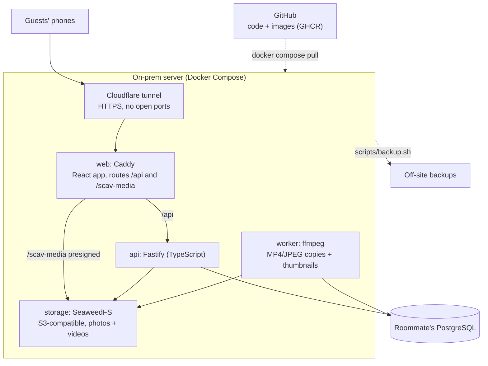

# Architecture

## Pieces

| Service | Role |
|---|---|
| **web** | Caddy serves the built React app and is the only entry point. `/api/*` goes to the API; `/scav-media/*` goes to SeaweedFS, keeping the original `Host` header so presigned signatures stay valid. |
| **api** | Sign-in, quests, submissions, scoring, the Game Master endpoints, and presigned upload/download links. Applies migrations and seeds on start. |
| **worker** | Same image as the API, different command. Claims jobs from Postgres (`FOR UPDATE SKIP LOCKED`, woken by `NOTIFY`), converts videos to H.264 MP4 and photos to JPEG, and makes thumbnails. Failed jobs retry 3 times; originals always remain available. |
| **storage** | SeaweedFS in single-container mode with its S3 gateway. MinIO's free edition stopped publishing images in October 2025, so SeaweedFS (Apache-2.0, actively maintained) takes its place. |
| **db** | PostgreSQL. In production, the roommate's existing server; on laptops, a container behind the `localdb` profile. |
| **tunnel** | `cloudflared`, behind the `tunnel` profile. |

## Upload flow

1. The browser asks `POST /api/uploads` for a slot. The API checks the type (photo/video) and size, creates a `media` row, and returns a presigned PUT URL for `PUBLIC_URL/scav-media/originals/...`.
2. The browser uploads straight to storage through Caddy, with a progress bar. Video bytes never pass through the API.
3. `POST /api/uploads/:id/complete` confirms the object exists.
4. `POST /api/submissions` attaches the uploaded media (and any text) to a submission for the player's team, and queues a job per file.
5. The worker writes `processed/<id>/display.(mp4|jpg)` and `thumb.jpg` and marks the media `ready`.
6. Media is viewed through `GET /api/media/:id/(thumb|display|original)`, which checks visibility and redirects to a short-lived presigned GET.

## Data model

- **teams**, **players** (`is_admin` marks the Game Master), **categories**, **quests**
- **submissions**: one per proof attempt, per team; `pending → approved | rejected`, with `points_awarded` and an optional note to the team
- **media**: original/display/thumb keys, processing status
- **jobs**: the worker queue
- **team_scores** (view): each team scores a quest once, at its best approved submission

## Rules encoded in the app

- Total points for a quest = base + distance bonus + 5 for group quests. The Game Master can override when approving.
- Approved proof is visible to everyone (the Feed). Pending and rejected proof is visible only to that team and the Game Master.
- Teams can withdraw a submission until it's reviewed.
- Hiding a quest removes it for players without deleting anything.
